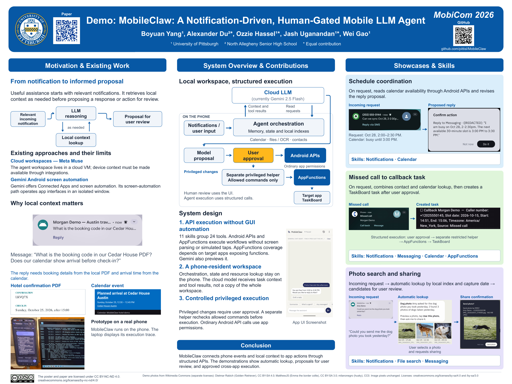

# MobileClaw

**A notification-driven mobile agent with shared local context and user-confirmed actions.**

[Paper](https://doi.org/10.1145/3795866.3848463)
· [Poster](docs/media/poster.pdf)
· [Demo video](#see-the-demo)
· [Download APK](docs/install.md)
· [Quick start](docs/quickstart.md)

MobileClaw is an Android research prototype developed at the
[Intelligent Systems Lab (PittISL)](https://github.com/pittisl), University of
Pittsburgh. Notifications can initiate contextual assistance, and foreground chat
uses the same phone-local conversations, memories and tool results. The phone
coordinates the agent loop and executes tools through Android interfaces.

MobileClaw uses a cloud model service by default and can connect to any
OpenAI-compatible model server, including locally hosted models and servers
running on the phone over loopback. It does not bundle an LLM or an inference
engine.

## See the demo

https://github.com/user-attachments/assets/63d7d44b-3431-467d-8123-d2c5fae9c4eb

[Download the demo video (MP4, 1920 × 1080, 125 seconds)](https://github.com/pittisl/MobileClaw/raw/refs/heads/main/docs/media/demo.mp4).
See the [demo setup guide](docs/demo.md) for reproducible examples.

<a href="docs/media/poster.pdf"></a>

[Download the poster as a PDF](docs/media/poster.pdf).

### See MobileClaw live at MobiCom 2026

Join us for an in-person demonstration of MobileClaw at ACM MobiCom 2026.

- **When:** Thursday, October 29, 2026, 4:00–6:00 p.m. CDT (Austin local time),
  during the Work in Progress II & Demos session.
- **Where:** Shirley Bird Perry Ballroom, Texas Union, The University of Texas at
  Austin, 2308 Whitis Ave, Austin, TX 78712, USA.

Our presentation, **Demo: MobileClaw: A Notification-Driven, Human-Gated Mobile
LLM Agent**, is demo **89** in the
[official demo listing](https://sigmobile.org/mobicom/2026/accepted_demos.html).
See the [conference program](https://sigmobile.org/mobicom/2026/program.html) and
[venue information](https://sigmobile.org/mobicom/2026/venue.html) for details.

## What MobileClaw demonstrates

- **Notification-driven assistance.** Background triage identifies notifications
  needing attention. Selected notifications trigger a bounded follow-up that
  reads relevant context and prepares a suggestion. For a photo request, actual
  local search results can appear as candidate cards in the request's conversation.
  The user previews and selects a photo, then explicitly requests sharing and
  confirms the image and recipient.
- **Shared state on the phone.** Foreground chat and background assistance use the
  same notification state, conversation history, memories and action records.
  Local document and image indexing supplies task context.
- **Structured tool execution.** Tools use notification actions, Android APIs and
  Android 16 AppFunctions exposed by cooperating apps. The included TaskBoard app
  makes the cross-app example reproducible.
- **User control over actions.** Outward actions require confirmation by default.
  Full Automation Mode can run eligible proposals automatically; privileged
  modifications, AppFunctions calls and selected-photo sending still require
  approval.

The prototype and its prompts are developed for English-language use. An
AppFunctions target must expose compatible functions; available operations depend
on the app, Android version and permissions. Connecting a different model service
does not establish that it matches the demonstrated model's task performance.

## Try it

1. Follow [installation and APK downloads](docs/install.md), or
   [build from source](docs/building.md). We recommend Android 16+ for MobileClaw;
   Android 8.0+ is the minimum supported version. Supported architectures are
   `arm64-v8a` and `x86_64`. The TaskBoard AppFunctions example requires Android 16+.
2. Open **Settings > Model service**, choose a provider, and enter your own model
   and connection details. Distributed APKs contain no team API key.
3. Use **Test connection**, save the service, and grant notification access.
4. Keep **Full Automation Mode** off and follow the
   [quick start](docs/quickstart.md) to try a synthetic notification.

The standard APK includes text, OCR and image-label search. Optional MobileCLIP
weights for image/text similarity are available through the
[source-build instructions](docs/building.md#optional-image-similarity).
The [notification-to-photo walkthrough](docs/demo.md#4-photo-request-to-candidate-cards)
uses a known fixture filename so the candidate/selection flow can be tried
without those optional weights.
TaskBoard and [Shizuku](https://shizuku.rikka.app/) are optional for ordinary chat
and notification use.

## Documentation

| Guide | Contents |
|---|---|
| [Installation](docs/install.md) | Signed APKs, verification and installation |
| [Quick start](docs/quickstart.md) | First connection, permissions and a sample interaction |
| [Model services](docs/model-configuration.md) | Gemini, OpenAI, custom endpoints, local inference and credential storage |
| [Skills and tools](docs/skills.md) | 11 Skills, 24 tools, permissions, confirmation rules and service requirements |
| [Demo setup](docs/demo.md) | Notification actions, document search, calendar and TaskBoard examples |
| [Architecture](docs/architecture.md) | Agent loops, shared state, tools, search and action confirmation |
| [Data and permissions](docs/privacy.md) | What stays on the phone, what reaches a model, and review/export controls |
| [Building and testing](docs/building.md) | Toolchain, optional models, development builds and tests |

## Paper and citation

Boyuan Yang, Alexander Du, Ozzie Hassel, Jash Uganandan, and Wei Gao.
**Demo: MobileClaw: A Notification-Driven, Human-Gated Mobile LLM Agent.**
ACM MobiCom 2026. [DOI: 10.1145/3795866.3848463](https://doi.org/10.1145/3795866.3848463).

```bibtex
@inproceedings{yang2026mobileclaw,
  author = {Yang, Boyuan and Du, Alexander and Hassel, Ozzie and
            Uganandan, Jash and Gao, Wei},
  title = {Demo: {MobileClaw}: A Notification-Driven, Human-Gated Mobile {LLM} Agent},
  booktitle = {Proceedings of the 32nd Annual International Conference on Mobile Computing and Networking},
  year = {2026},
  doi = {10.1145/3795866.3848463},
  url = {https://doi.org/10.1145/3795866.3848463}
}
```

Machine-readable citation information is in [CITATION.cff](CITATION.cff).

## Source and license

`app/` contains MobileClaw; `demotarget/` contains the separate TaskBoard app;
`tools/` contains fixtures, demo helpers, model downloads and evaluation tools;
`docs/` contains the guides and presentation media.

Project code is [MIT-licensed](LICENSE). See [contributors](CONTRIBUTORS.md) and
[third-party notices](THIRD_PARTY_NOTICES.md) for attribution. Third-party models,
fonts and sample images retain their respective licenses.
